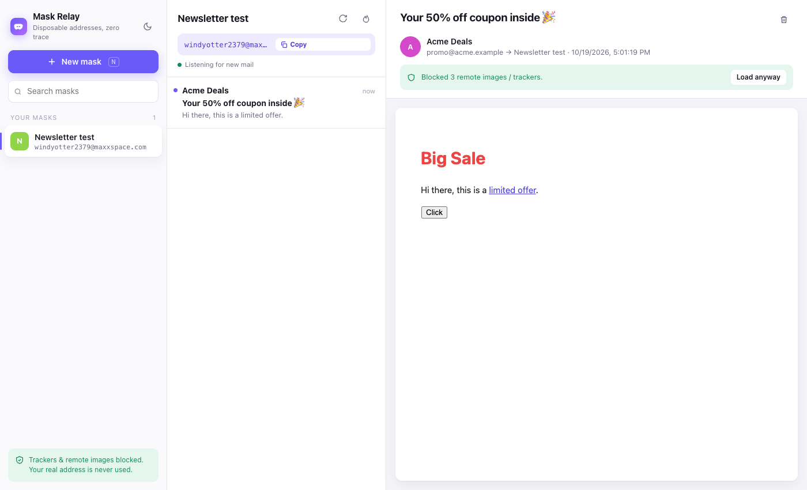

<p align="center"></p>
<h1 align="center">Mask Relay</h1>
<p align="center">Disposable masked email addresses with a private, tracker-blocking inbox.<br>Keep newsletters, ads and spam out of your real mailbox.</p>
<p align="center">
  <a href="https://github.com/exexexexe/mask-relay/releases/latest/download/MaskRelay.dmg"></a>
  <a href="https://github.com/exexexexe/mask-relay/releases/latest/download/mask-relay-firefox.zip"></a>
  <br><sub><a href="https://github.com/exexexexe/mask-relay/releases">All releases &amp; checksums</a></sub>
</p>



## What it does

- **One-click masks** — get a random address like `windyotter2379@maxxspace.com`, already copied to your clipboard. Give it a label ("Spotify") so you remember where you used it.
- **Read mail through the mask** — everything sent to a mask shows up in Mask Relay, never in your real inbox. New mail appears automatically.
- **Tracker-proof reader** — emails render in a sandboxed viewer with scripts, forms and remote content blocked, so tracking pixels can't report that you opened a message or leak your IP. Load images per-message only if you choose to.
- **Burn a mask** — when an address starts getting spam, delete it. Anything still sending to it bounces.
- **Firefox extras** — right-click any email field → *Fill with a new Mask Relay address*; toolbar popup for quick masks; unread badge and new-mail notifications.
- Light & dark themes, keyboard-driven, works at any window size.

| Shortcut | Action |
|---|---|
| `N` | New mask |
| `/` | Search masks |
| `C` | Copy current address |
| `R` | Refresh |
| `J` / `K` or `↓` / `↑` | Next / previous message |
| `Delete` | Delete message |
| `Alt+Shift+M` | Open popup (Firefox) |

## Install

### macOS (12 Monterey or later, Apple Silicon & Intel)

1. Download [**MaskRelay.dmg**](https://github.com/exexexexe/mask-relay/releases/latest/download/MaskRelay.dmg) and drag **Mask Relay** to Applications.
2. The app is not notarized by Apple, so the first launch is blocked. Open it once, then go to **System Settings → Privacy & Security → Open Anyway**. (Or run `xattr -dr com.apple.quarantine "/Applications/Mask Relay.app"`.)

### Firefox (128+)

Download [**mask-relay-firefox.zip**](https://github.com/exexexexe/mask-relay/releases/latest/download/mask-relay-firefox.zip) (same add-on as the `.xpi`; the `.zip` link downloads instead of Firefox trying to install it). It is not yet signed by Mozilla, so release Firefox only loads it temporarily:

- **Try it:** `about:debugging#/runtime/this-firefox` → *Load Temporary Add-on…* → pick the `.zip` (or `.xpi`) (removed when Firefox restarts).
- **Permanent:** use Firefox Developer Edition / Nightly with `xpinstall.signatures.required = false` in `about:config`, then drag the `.xpi` into Firefox — or sign it yourself (see below).

## Privacy model

| | |
|---|---|
| **Your real address** | Never used, never stored, never sent anywhere. |
| **Labels** | Stored only on your device. The provider never sees them. |
| **Masks** | Each mask is a separate account with a random address and random 28-char password. Nothing in an address points to you. |
| **Storage** | macOS: `~/Library/Application Support/Mask Relay/masks.json` (owner-only, `0600`). Firefox: extension local storage. No sync, no cloud, no telemetry. |
| **Viewer** | Sandboxed iframe + strict CSP; `<script>`, event handlers, forms, iframes and remote images/CSS are removed before rendering. Links open with no referrer. |
| **Network** | The only server contacted is the mail provider (`api.mail.tm`). The macOS app enforces this in native code. |

**Limits — please read:**

- Masks use [mail.tm](https://mail.tm), a free public disposable-mail service. mail.tm can read mail sent to your masks and sees your IP address when the app checks for mail, so it could tell that several masks belong to the same person. It can't connect them to your real identity — use a VPN if you want to hide your IP too.
- Receive-only: you can't send or reply from a mask.
- Some sites block disposable domains.
- Don't use masks for accounts you need to recover later (banking, Apple ID, work). If the provider deletes an inbox, that mail is gone.

## Build from source

Requires macOS with Xcode Command Line Tools (`xcode-select --install`).

```sh
./scripts/build.sh
# → dist/MaskRelay-<version>.dmg
# → dist/mask-relay-<version>.xpi
```

To sign the Firefox add-on for permanent install, get API keys from [addons.mozilla.org](https://addons.mozilla.org/developers/addon/api/key/) and run:

```sh
npx web-ext sign --channel=unlisted -s build/firefox --api-key=$AMO_JWT_ISSUER --api-secret=$AMO_JWT_SECRET
```

### Layout

```
shared/     UI (app.html/css/js) and core.js — mail.tm client + message sanitiser, used by both builds
extension/  Firefox manifest, storage/network adapter, background (badge, notifications, context menu), popup
macos/      Swift app (WKWebView + native bridge restricted to api.mail.tm), Info.plist, icon renderer
scripts/    build.sh
```

## License

MIT
